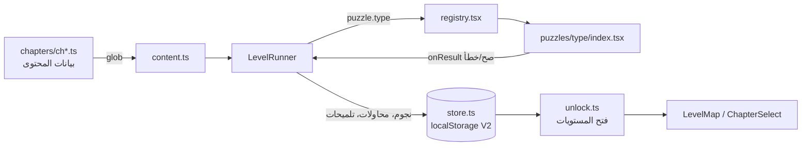

# 3. البنية والتصميم التقني

## 3.1 لماذا Vite وReact وTypeScript
اللعبة تطبيق ويب يعمل كله في متصفح اللاعبة، بلا خادم ولا حساب مستخدم. اخترنا **Vite** لسرعة البناء وبساطة النشر (ملفات ثابتة)، و**React** لأن كل لغز واجهة تفاعلية بحالة محلية، و**TypeScript** لأن الفريق ستة حسابات تكتب بالتوازي، والأنواع تحوّل أي مخالفة للعقد إلى خطأ بناء قبل أن تصل اللاعبة. الأسلوب: Tailwind للمكوّنات، وCSS مخصّص لهوية الواجهة، والراوتر مبني على `location.hash` فلا يحتاج الاستضافة إلى إعدادات إعادة توجيه.

## 3.2 فصل المحتوى عن المحرّك
القصة والألغاز **بيانات** لا كود. كل فصل ملف `chapters/chN.ts` يصدّر كائناً بالنوع `Chapter`، وكل مستوى فيه عنوان وحوار وأدلة وثلاثة تلميحات وكائن `puzzle` يصف اللغز. المحرّك لا يعرف أي مستوى بعينه: يجمع الملفات تلقائياً (`import.meta.glob`)، ويرتّبها، ويحسب الفتح من الترتيب (المستوى يُفتح بإكمال السابق، والفصل بإكمال آخر مستوى في الفصل قبله). ولأن المحتوى بيانات، كتبه عدة حسابات بلا لمس مجلدات بعضهم، ويفحصه سكربت `test:content` آلياً: تطابق المعرّفات، وعدد التلميحات والأدلة، ووجود الحل بين العناصر، وإمكان بلوغ هدف الميزان، وغيرها.

## 3.3 عقد اللغز وتسجيل الأنواع
لكل نوع من الألغاز الاثني عشر (ترتيب، بحث في المشهد، مطابقة، قفل رموز، اختيار، مسار، ميزان، تدوير قطع، ذاكرة، شفرة، استنتاج، تركيب) مكوّن React واحد في `puzzles/<type>/index.tsx`، وعقده:

```ts
interface PuzzleProps<C> {
  config: C;                   // وصف اللغز من ملف المحتوى
  background: string;
  hintLevel: 0 | 1 | 2 | 3;    // المحرّك يمرّره
  onResult(correct: boolean): void;
}
```

المكوّن يعرض اللغز ويبلغ فقط **صحيح/خطأ** عند كل تأكيد. **النجوم** والمحاولات والتلميحات والفتح والحفظ كلها من اختصاص المحرّك، فلا يستطيع لغز أن يكسر قواعد التقدّم. `registry.tsx` يعثر على المكوّنات بـ glob ويحمّلها كسولاً، فنوع لم يصل ملفه لا يكسر البناء (يظهر مكانه مستطيل «قيد التطوير» في التطوير ورسالة هادئة في الإنتاج).



## 3.4 حفظ التقدّم V2 والترحيل
التقدّم يُحفظ في `localStorage` تحت المفتاح `nile-secrets-progress-v2`: مستويات مكتملة (لكل منها نجوم وعدد تلميحات ومحاولات)، والأدلة المكتشفة، وآخر مستوى، والإعدادات. عند الفتح يُتحقَّق من شكل المحفوظ ويُدمج مع القيم الافتراضية فلا ينهار الحفظ التالف. النسخة الأولى من اللعبة كانت تحفظ خمس «مراحل» فقط؛ دالة صافية في `migrate.ts` تحوّلها إلى مستويات مقابلة بنجمة واحدة (مثلاً مرحلة «السوق» تصير `c3-l1`)، وعليها اختبار آلي (`test:migrate`). إن تعذّر الحفظ في المتصفح تُعرض رسالة تحذير بدل الصمت.

## 3.5 كيف يُضاف فصل وحدود التوسّع
إضافة فصل في المحتوى سهلة بقدر ما سبق: `node scripts/new-chapter.mjs 6` ينتج ملفاً من قالب بسبعة مستويات يمرّ الفاحص مباشرة، والدليل `docs/ADD_CHAPTER.md` يشرح الشخصيات والصور والرمز والتحقق.

لكن **الواجهة اليوم مبنية على خمسة فصول**، وقد فحصنا ذلك بصدق في `docs/EXPANSION_GAPS.md`: محطات الخريطة الخمس ثابتة المواضع، وإجمالي المستويات ثابت عند 35، وقطعة الخريطة تُقتطع من صورة بست خلايا فقط، والخاتمة مربوطة بالفصل الخامس، وفكرة «سبعة مستويات في الفصل والبوس السابع» مكتوبة في أكثر من موضع. قدّرنا نحو 12 ساعة عمل لإظهار فصل سادس وما بعده، وأكثر لتصميم خريطة تتسع لعشرين فصلاً. لذلك **مشروع المئة مستوى مؤجَّل لما بعد التسليم**، وما يعمل فعلاً هو الخمسة والثلاثون مستوى.

## 3.6 ما لم نختبره
- لم تُجرَّب اللعبة مع لاعبين حقيقيين؛ اختبارنا آلي (أنواع، بناء، فحص المحتوى، فتح، ترحيل) ويدوي في متصفح سطح المكتب بعرض الهاتف (375 بكسل). **السحب باللمس** لم يُجرَّب على جهاز فعلي.
- **الصور:** كثير من مستويات الفصول 3 و4 ما زال يعتمد على الخلفية البديلة لأن صورها لم تصل عند كتابة هذا الفصل. لذلك لم نجرّب مستوياتها مع صورتها: إحداثيات مستوى «الدكان الناقص» (c3-l5) مؤقتة حتى تصل صورته، وألغاز التبديل بصورة حقيقية (c4-l2) وحجم الأهداف على الشاشة الصغيرة لم نقسهما.
- **الاتساق بين النص والصورة:** راجعنا برومبتات الصور مقابل الدلائل (docs/prompts/REVIEW_E.md) وصحّحنا تناقضات بينها، لكن المراجعة على النص لا على الصور المولَّدة نفسها، وقد تخرج الصورة النهائية مخالفة لما طلبناه.
- وحدانية حلول الألغاز المنطقية مُتحقَّق منها بسكربت حصر للجداول والميزان فقط، أما بقية الألغاز فمراجعتها بشرية.
- كُتب جزء كبير من الكود والنصوص بمساعدة الذكاء الاصطناعي (Claude) تحت إشراف الفريق ومراجعته، وهذا مفصَّل في الفصل 7.
